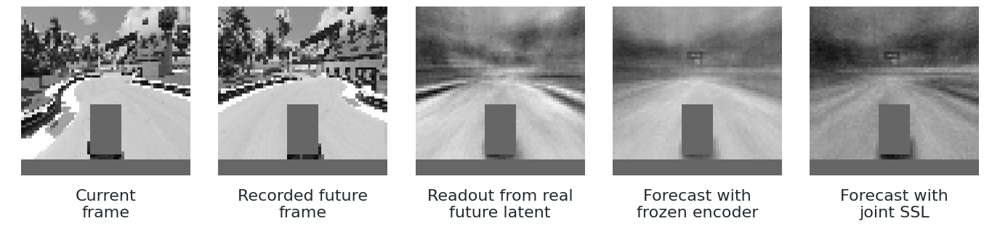

# JEPAMania

A JEPA based learning approach for entirely autonomous racing on Trackmania.
The original goal was to create a generalized encoder + predictor that captures the essential "features" required to drive on its own,
with a short RL phase required afterwards for fine tuning it to speed run a given map.

The data used for the self supervised learning phase can be found at: https://huggingface.co/datasets/akkshaysr/jepamania-data.

The project is currently paused due to the RL phase requiring more time and compute than I have on my hands right now. More details in the [project status section](#project-status).

## Architecture

JEPAMania uses JAX and Equinox. The `win-client` package handles game I/O and
recording, `core` contains the model and planner, and `train` handles episode
sampling and model updates.

### Game observations

On Windows, the client uses TMRL and `rtgym` to step Trackmania at 20 Hz.
The driver keeps four consecutive 64 × 64 grayscale frames, speed, gear,
RPM, and the last two executed controls. A control is a gas, brake, and
steering triple. Native `rtgym` returns the observation for the completed
interval as it sends the next control, so the driver records the action
that actually ran during the interval. Human drives and rollouts from a
pretrained SAC agent can be saved as HDF5 episodes for offline training. New
offline recordings store observations and continuous controls. Live RL replay
also stores discrete action IDs, rewards, and race-ending labels.
[Game session](win-client/src/win_client/game_session.py) · [Recorder](win-client/record.py)

### World model

The world model uses a Joint Embedding Predictive Architecture (JEPA).
A small convolutional stem turns the four-frame stack into a 4 × 4 grid
of visual tokens. The encoder adds one token for speed, gear, and RPM,
passes the tokens through two vision transformer blocks, and pools them
into a 128-value embedding. The two past controls are appended directly,
bringing the default state to 134 values.
[Encoder](core/src/core/encoders.py) · [Model configuration](core/config.yaml)

Given the current state and a proposed control, the predictor (a residual MLP)
predicts the change to the learned embedding. The control history drops the
oldest control and appends the proposed one. The predictor learns the dynamics
of the car in latent space, allowing the model to test rollouts in latent space
and "imagine" what would have happened if a proposed action took place.
[Dynamics](core/src/core/dynamics.py)

### Windows controller

A shared head predicts the immediate reward and probability of ending the
race for each action, plus one value for continuing from the state. The
driver uses 54 discrete actions from nine steering angles and six gas/brake
settings.

Model-predictive control (MPC) uses the cross-entropy method (CEM) to sample
five-step sequences and update the per-step action probabilities using
the best-scoring candidates.

The score adds discounted rewards along the sequence and the discounted value
at the final predicted state. Each term is weighted by the probability that
the race has continued to that point. The driver sends the first action of
the chosen sequence and replans from the next observation.
[Action grid](core/src/core/actions.py) · [Planner](core/src/core/planners.py) · [Driver](win-client/src/win_client/mpc_driver.py)

<p align="center">
  
</p>

## Training

### Offline pretraining

The loader samples complete five-step windows within recorded episodes. The
predictor rolls forward using the recorded controls, including steering
angles between the planner's discrete choices. The same encoder turns the
actual observation at each future step into a target. The prediction loss
compares the 128 learned values at each step.
[Episode loader](train/src/train/dataloader.py) · [Pretraining](train/src/train/pretrain.py)

Sub-JEPA loss is used to prevent the collapse of embeddings into a degenerate state.
It projects the target embeddings into fixed subspaces and rewards the model for having
a Gaussian like distribution in randomly drawn one dimensional slices of each subspace
as a way to increase its variance and "use" more of its latent capacity to store features.
[Training loss](train/src/train/loss.py)

### Online learning

The online loop loads a pretrained encoder and predictor and initializes the
shared head. Each epoch collects a batch of drives, runs a fixed number of
optimizer attempts, and publishes a checkpoint. A throttle-biased heuristic
drives the early epochs. CEM uses one frozen model snapshot for each later
collection batch. Replay distinguishes genuine race endings from collection
cutoffs with a valid final observation.
[Online loop](rl_loop.py) · [Replay writer](train/src/train/rollout_episodes.py)

The update combines Sub-JEPA with mean squared error for reward and scalar
value, and binary cross-entropy for termination. It trains on observed and
imagined states. The value targets use recorded rewards and a slowly updated
value estimate at the last real observation when the race continues.
The RL targets come from live replay, and Sub-JEPA can also use historical
observations and actions.

Set `finetune.evaluation_interval` to an epoch count to enable evaluation.
Separate CEM races use the checkpoint just published, and `evaluation.jsonl`
records finish rate, median successful lap time, mean discounted return,
and p99 inference latency.
[Online updates](train/src/train/finetune.py) · [Epoch settings](train/config.yaml)

### Running the code

Run these commands from the repository root. Install the locked dependencies
with `uv sync --locked`. Pretraining reads HDF5 recordings and exports the
encoder and predictor.

```sh
uv run python -m train.pretrain --data-dir win-client/data/ssl --checkpoint-dir checkpoints/pretrain
```

Recording and live driving use TMRL and the Openplanet plugin on Windows.
Online RL and checkpoint driving require TMRL's virtual gamepad.

```sh
uv run python win-client/record.py --mode human
uv run python rl_loop.py --initialize checkpoints/pretrain/world_model.eqx --run-dir checkpoints/online
uv run python rl_loop.py --resume --run-dir checkpoints/online
uv run python win-client/run.py --checkpoint-path checkpoints/online/driver.eqx
```

Stop recording with Ctrl+C. Agent recording uses `--mode agent` with a SAC
checkpoint configured in [`win-client/settings.yaml`](win-client/settings.yaml).
Use `--resume` to continue an interrupted run with the same run directory and
settings.

To migrate from an older Q checkpoint, start a fresh scalar-value run from a
`world_model.eqx` that matches the encoder and predictor settings. The online
learner picks up a neighboring `projectors.eqx` when SSL is enabled.

## Offline experiments

### Recordings and baselines

The early CPU runs tested whether adding control history improved speed
forecasts and whether the model could beat simple forecast baselines. Giving
the model the last two controls improved speed forecasts. Extrapolating the
last change in speed was still more accurate. Several image forecasts scored
about the same as repeating the current frame on the road-facing region.

For the follow-up experiments I used human recordings only.

### Image readouts and rollout error

To measure how much visual detail the encoder retained and how much survived a
five-step rollout, I fitted a fresh image decoder for each encoder. It
reconstructed the latest frame in the observation from the 128 learned values.
A readout from the recorded future embedding shows what the decoder can
recover from the actual future observation. A readout from the predicted
embedding shows how much detail survives the rollout.



*A clip selected near the median five-step forecast error for the frozen
encoder. The real-future readout uses the same encoder. Gray masks mark the
car and lower HUD, which are excluded from the pixel score.*

With the encoder frozen, the predictor fit one-step transitions on 64 clips.
Errors grew when it rolled forward from its own predictions. Training on
five-step rollouts brought the five-step embedding error on those clips down
to about 2% of the error from holding the initial embedding fixed. On the
development episodes, image forecasts improved when the predictor received
the recorded embedding at each step.

### Frozen and joint training

This comparison tested whether updating the encoder along with the predictor
improved five-step forecasts or preserved more detail in the real-future
readout. Each run started from the same visually pretrained model and used
1,536 updates with batches of 24 five-step windows. The evaluation used 320
windows from 16 episodes held out from training and reused during development.

Scores are the mean squared pixel error in the road-facing region divided by
the error from repeating the current frame (`1.000`). The mean training image
scored `0.809`. Lower is better. Each cell lists seeds 17 and 42 in that order.

| Training condition | Five-step forecast | Real-future readout |
| --- | ---: | ---: |
| Frozen encoder | 0.592 / 0.597 | 0.380 / 0.380 |
| Joint Sub-JEPA, regularizer weight 0.02 | 0.738 / 0.718 | 0.475 / 0.477 |
| Joint Sub-JEPA, regularizer weight 0.002 | 0.652 / 0.672 | 0.531 / 0.535 |

Freezing the encoder gave the lowest error in both columns. All three
forecasts beat the mean training image. In earlier diagnostics, Sub-JEPA
trained from scratch fell short of that baseline. Adding an image
reconstruction loss recovered some of the forecast accuracy lost in joint
training.

At the starting checkpoint, the median ratio of encoder gradient norms was
about 16 to 1 for the weighted regularizer and the prediction loss. Reducing
the regularizer weight improved the five-step forecast and worsened the
real-future readout. The loss weights and the changing targets from the shared
encoder may both have contributed to the result. Performance on new recordings
remains open.

### Steering sensitivity

Shuffling steering between clips hurt the stronger forecasts. Holding the
previous steering angle gave nearly the same errors as replaying the
recorded steering. These checks showed that the forecasts responded to
steering inputs. Each clip supplied only the future that actually happened,
so the effect of choosing a different steering angle remained open.

## Project status

The project is paused indefinitely. Two main issues kept me from my original
goal of building a general driving model that I could fine-tune to a given map
with a short RL phase.

1. The SSL data comes from the [TMRL agent](https://github.com/trackmania-rl/tmrl)
   and a few hours of me playing. I added noise to the agent's controls to
   get more varied driving scenarios. Even so, the roughly 10 hours I collected
   cover too few driving situations for the model to learn features that
   generalize across Trackmania. I do not see a way to collect more data
   efficiently. Agents tend to be trained on a specific map and follow similar
   racing lines. Collecting my own data across different maps is also hard to
   scale.

2. The online RL loop collects drives and trains on the completed episodes
   before the next collection batch. Without a GPU on the Windows machine
   where I play Trackmania, those updates would take much longer. Running a
   single game instance also limits how quickly I can collect observations.
   The SSL phase fell short of what I wanted the model to learn, which leaves
   more work for RL and makes it harder to get the model to a usable state.

CPU simulation covers replay, checkpoint recovery, and CEM scoring. Live
Trackmania capture, driving behavior, and inference latency still need a
Windows trial. Held-out live drives are needed to check termination and value
predictions.

## License

[MIT License](LICENSE)
