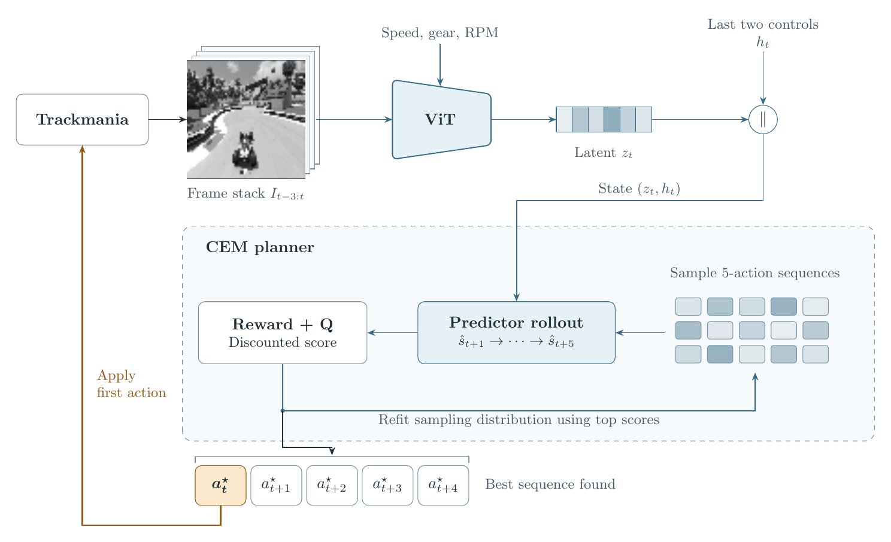

# JEPAMania

A JEPA based learning approach for entirely autonomous racing on Trackmania.
The original goal was to create a generalized encoder + predictor that captures the essential "features" required to drive on its own,
with a short RL phase required afterwards for fine tuning it to speed run a given map.

The data used for the self supervised learning phase can be found at: https://huggingface.co/datasets/akkshaysr/jepamania-data.

The project is currently paused due to the RL phase requiring more time and compute than I have on my hands right now. More details in the [project status section](#project-status).

## Architecture

JEPAMania uses JAX and Equinox. The `win-client` package handles game I/O and
recording, `core` contains the model and planner, and `train` handles episode
sampling and model updates.

### Game observations

On Windows, the client uses TMRL and `rtgym` to step Trackmania at 20 Hz.
The driver keeps four consecutive 64 × 64 grayscale frames, speed, gear,
RPM, and the last two executed controls. A control is a gas, brake, and
steering triple. Native `rtgym` returns the observation for the completed
interval as it sends the next control, so the driver records the action
that actually ran during the interval. Human drives and rollouts from a
pretrained SAC agent can be saved as HDF5 episodes for offline training.
[Game session](win-client/src/win_client/game_session.py) · [Recorder](win-client/record.py)

### World model

The world model uses a Joint Embedding Predictive Architecture (JEPA).
A small convolutional stem turns the four-frame stack into a 4 × 4 grid
of visual tokens. The encoder adds one token for speed, gear, and RPM,
passes the tokens through two vision transformer blocks, and pools them
into a 128-value embedding. The two past controls are appended directly,
bringing the state to 134 values. This state (in latent space) is meant to capture 
and compress the required information to drive the model. 
[Encoder](core/src/core/encoders.py) · [Model configuration](core/config.yaml)

Given the current state and a proposed control, the predictor (a residual MLP)
predicts the change to the learned embedding. The control history drops the
oldest control and appends the proposed one. The predictor learns the dynamics
of the car in latent space, allowing the model to test rollouts in latent space
and "imagine" what would have happened if a proposed action took place.
[Dynamics](core/src/core/dynamics.py)

### Windows controller

A shared network reads the model state and predicts the next interval's
reward and the Q-value, for each action. The driver uses 54 discrete actions
from nine steering angles and six gas/brake settings. Greedy Q picks the action
with the highest predicted return. 

Model-predictive control (MPC) uses the cross-entropy method (CEM) to sample
five-step sequences and update the per-step action probabilities using
the best-scoring candidates.

A sequence's score is the sum of discounted predicted rewards plus the
discounted best Q-value at the final predicted state. The driver sends the
first action of the chosen sequence and replans from the next observation.
[Action grid](core/src/core/actions.py) · [Planner](core/src/core/planners.py) · [Driver](win-client/src/win_client/mpc_driver.py)

  

## Training

### Offline pretraining

The loader samples complete five-step windows within recorded episodes. The
predictor rolls forward using the recorded controls, including steering
angles between the planner's discrete choices. The same encoder turns the
actual observation at each future step into a target. The prediction loss
compares the 128 learned values at each step.
[Episode loader](train/src/train/dataloader.py) · [Pretraining](train/src/train/pretrain.py)

Sub-JEPA loss is used to prevent the collapse of embeddings into a degenerate state.
It projects the target embeddings into fixed subspaces and rewards the model for having
a Gaussian like distribution in randomly drawn one dimensional slices of each subspace
as a way to increase its variance and "use" more of its latent capacity to store features.
[Training loss](train/src/train/loss.py)

### Online learning

The online loop loads a pretrained encoder and predictor and adds a shared
reward and Q head. The driver holds a fixed model snapshot during an episode
while the learner updates from completed HDF5 recordings in the background.
Replay distinguishes game terminals from collection cuts with a valid final
observation. It skips transitions that are missing their next observation.
[Online loop](rl_loop.py) · [Replay writer](train/src/train/rollout_episodes.py)

The update combines Sub-JEPA with reward prediction and Double DQN.
Sub-JEPA can use both offline and online windows. Recorded rewards and
TD targets supervise the head on observed states and states predicted
along the recorded control sequence. The code supports frozen-encoder and
RL-only comparisons. Evaluation uses the same snapshot for greedy Q and
MPC, with the MPC runs gated on a reward forecast check on evaluation drives.
[Online updates](train/src/train/finetune.py) · [Evaluation](rl_loop.py#L326)

## Offline experiments

### Recordings and baselines

In early CPU runs, adding explicit control history improved speed forecasts.
Extrapolating the last speed change was still more accurate. Several image
forecasts scored about the same as repeating the current frame on the
road-facing region. Using more embedding dimensions gave little indication
of which models retained useful visual geometry.

The human and SAC agent recordings came from different maps even though the
files gave them the same map label. The larger agent pool dominated the mix,
some control combinations were rare, and the logs lacked synchronized
timestamps to measure the delay between actions and screen captures. The
contribution of each issue to forecast error remains uncertain. For the
follow-up experiments I used human recordings and split by whole driving
episode before sampling clips.

### Image readouts and forecasts

I fitted a fresh image decoder for each encoder so the probe could learn
that encoder's coordinates. It used only the 128 learned values to reconstruct
the latest frame in the observation.
A readout from the **recorded future embedding** shows how much of the scene
the decoder can recover without any rollout error. A readout from the
**predicted embedding** shows what the model preserves over the rollout.

*A clip selected near the median five-step forecast error for the frozen
encoder. The real-future readout uses that same encoder. Gray masks cover the
car and bottom HUD, which are excluded from the pixel score.*

With the encoder frozen, the predictor could fit one-step transitions on
64 clips, but errors accumulated when it fed its own predictions back in.
Training on five-step rollouts brought the embedding error on those training
clips down to about 2% of the error from holding the initial embedding fixed.
On the development episodes, forecasts were more accurate when the predictor
received a recorded embedding at each step.

### Frozen and joint training

I started each condition from the same visually pretrained encoder and
predictor. Each run used 1,536 updates and batches of 24 five-step windows.
I evaluated on 320 windows from 16 held-out episodes reused during
development. Each cell gives the results for seeds 17 and 42. Scores are
road-facing pixel mean squared error divided by the error from repeating
the current frame (`1.000`). The mean training image scored `0.809`.
Lower is better.

| Training condition | Five-step forecast | Real-future readout |
| --- | ---: | ---: |
| Frozen encoder | 0.592 / 0.597 | 0.380 / 0.380 |
| Joint Sub-JEPA, regularizer weight 0.02 | 0.738 / 0.718 | 0.475 / 0.477 |
| Joint Sub-JEPA, regularizer weight 0.002 | 0.652 / 0.672 | 0.531 / 0.535 |

Freezing the encoder gave the lowest errors in both columns. All three
forecasts beat the mean training image. In an earlier diagnostic, training
Sub-JEPA from scratch fell short of that baseline, and adding an image
reconstruction term recovered some of the forecast accuracy lost in joint
training.

At the visual starting checkpoint, the weighted Gaussian regularizer's
encoder gradient was about 16 times as large as the prediction term's, by
median norm ratio across the batches I checked. Lowering the weight from
0.02 to 0.002 improved the five-step forecast and worsened the real-future
readout. The balance of the two loss terms and the changing targets from
the shared encoder are both possible contributors to the joint-training
result.

### Steering sensitivity

Shuffling steering between clips hurt the stronger forecasts. Holding the
previous steering angle gave nearly the same errors as replaying the
recorded steering. These checks showed that the forecasts responded to
steering inputs. Each clip supplied only the future that actually happened,
so the effect of choosing a different steering angle remained open.

## Project status

The project is paused indefinitely. Two main issues kept me from my original
goal of building a general driving model that I could fine-tune to a given map
with a short RL phase.

1. The SSL data comes from the [TMRL agent](https://github.com/trackmania-rl/tmrl)
   and a few hours of me playing. I added noise to the agent's controls to
   get more varied driving scenarios. Even so, the roughly 10 hours I collected
   cover too few driving situations for the model to learn features that
   generalize across Trackmania. I do not see a way to collect more data
   efficiently. Agents tend to be trained on a specific map and follow similar
   racing lines. Collecting my own data across different maps is also hard to
   scale.

2. The online RL loop is set up to collect rollouts while the model drives
   and train on completed episodes in the background. Later episodes can use
   the updated model. Without a GPU on the Windows machine where I play
   Trackmania, those updates would take much longer. Running a single game
   instance also limits how quickly I can collect observations for training.
   The SSL phase fell short of what I wanted the model to learn, which leaves
   more work for RL and makes it harder to get the model to a usable state.

## License

[MIT License](LICENSE)
